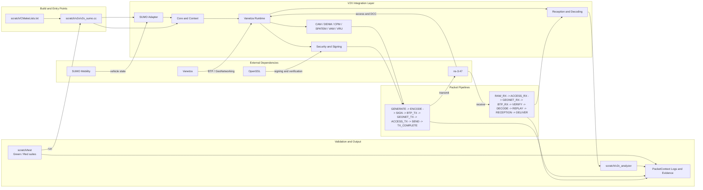
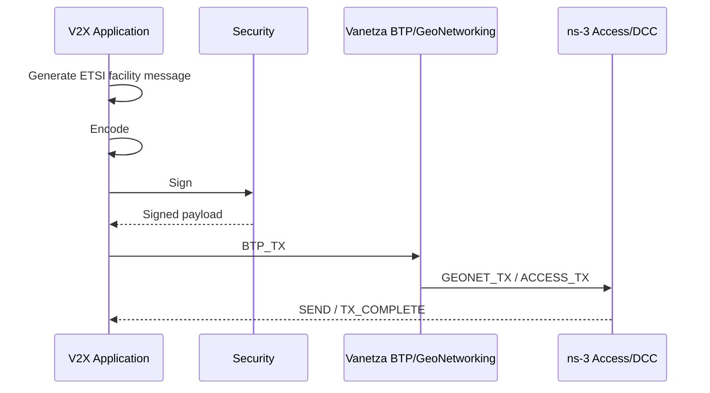
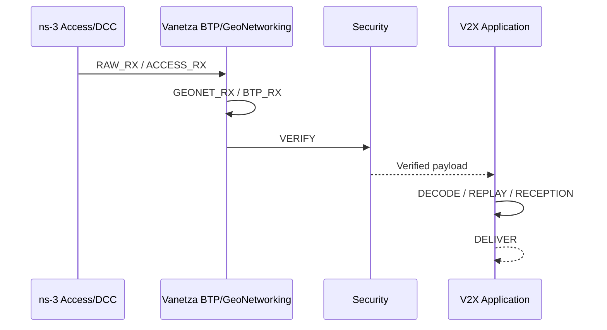

# V2X Project Architecture

## Overview

The repository integrates **ns-3.47**, **Vanetza**, **SUMO**, and ETSI V2X facilities. A simulation application synchronizes mobility from SUMO, exchanges ETSI messages through Vanetza and ns-3, and produces packet logs for analysis and validation.

## Major Components

- **Simulation entry point:** `scratch/v2x/v2x_sumo.cc` coordinates the SUMO-based scenario and ns-3 simulation.
- **Vanetza integration:** `scratch/vanetza_integration/` contains CAM, DENM, CPM, SPATEM, VAM, and VRU handling, plus runtime, security, context, reception, and SUMO adapters.
- **Message processing:** generated ETSI facilities are encoded, signed, sent through BTP and GeoNetworking, received, verified, decoded, and replayed.
- **SUMO synchronization:** the SUMO adapter supplies vehicle state and scenario mobility to the simulation.
- **Analyzer:** `scratch/v2x_analyzer/` parses V2X logs and computes validation metrics and reports.
- **Tests:** `scratch/test/` contains positive and negative CAM, DENM, and SPATEM suites.
- **Evidence:** runtime logs and collected evidence support functional validation.

## TX Flow

## RX Flow

