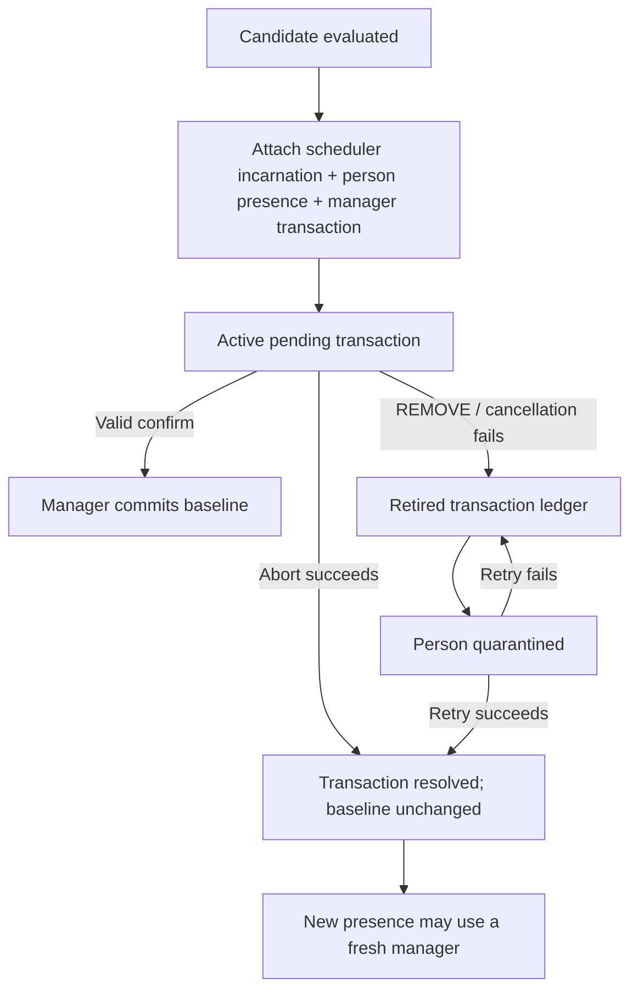
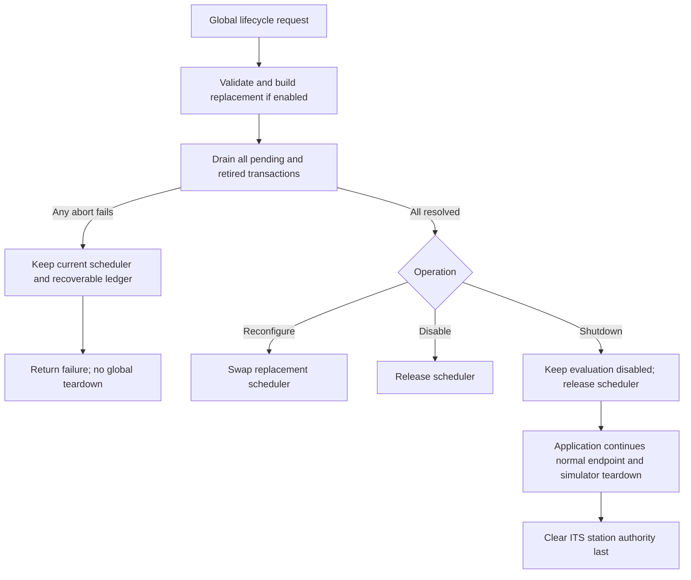

# Etapa 11.6 - VAM Transaction Lifecycle e TX Readiness - Plan

## Goal Capsule

- **Objective:** uma pessoa que regressa ao cenário recebe comportamento VAM independente da presença anterior; confirmações antigas não alteram o seu baseline e falhas de cancelamento não impedem a avaliação dos restantes sujeitos.
- **Means:** usar identificadores de transação vinculados à instância do scheduler e à presença, reter cancelamentos falhados, isolar a pessoa afetada e exigir a resolução global antes de substituir ou encerrar o scheduler (KTD5–KTD8).
- **Authority:** `SumoPersonRegistry` determina a presença aceite; `VamGenerationScheduler` gere as transações e o baseline dos managers; `SimulationController` coordena os eventos e o encerramento; `ItsStationIdentityAuthority` continua a ser a autoridade global para `stationId`.
- **Execution profile:** alteração C++23 compatível com GCC 11; uma simulação por processo; VAM permanece `EVALUATION_ONLY`.
- **Stop conditions:** uma reconfiguração, desativação ou shutdown global não pode prosseguir enquanto existir um cancelamento por resolver. Um shutdown falhado tem de produzir um resultado não-zero e não pode executar a destruição normal da simulação nem a limpeza global das identidades.
- **Tail ownership:** o executor segue as unidades por ordem de dependência e satisfaz o Verification Contract e a Definition of Done; a validação runtime continua a ser responsabilidade do executor, não se presume a partir da compilação.

---

## Product Contract

> Product Contract reestruturado sem alteração de âmbito: R1–R14, KTD1–KTD4, atores, fluxos, exemplos de aceitação e fronteiras de produto são preservados. As questões anteriormente adiadas para planeamento técnico passam para Planning Contract / Deferred to Implementation.

### Summary

A Etapa 11.6 torna as transações VAM seguras perante mudanças no ciclo de vida dos sujeitos. Uma confirmação só pode atualizar o baseline quando pertence à transação e à presença ainda válidas. Uma transação cujo cancelamento falhe permanece recuperável, mas não pode voltar a ser confirmada.

### Problem Frame

O scheduler atual remove o runtime de pessoas ausentes durante `EvaluateStep()`. Essa remoção também pode ocorrer num passo ignorado pela cadência. O manager mantém um identificador de transação local que começa em 1, pelo que o identificador, isoladamente, não distingue uma presença anterior de uma reentrada da mesma pessoa.

A confirmação e o aborto do scheduler localizam o candidato através de `personId` e `transactionId`. A reconfiguração, a desativação e o shutdown atuais podem eliminar o scheduler ou o seu runtime sem resolver primeiro todos os candidatos pendentes. Esse comportamento é aceitável no modo síncrono `EVALUATION_ONLY`, em que o controlador aborta cada candidato logo após a avaliação, mas não constitui um contrato seguro para futuras confirmações assíncronas.

### Key Decisions

- KTD1. **Identidade transacional vinculada ao ciclo de vida** — cada transação deve distinguir a instância de scheduler, a presença concreta da pessoa e o identificador local do manager. Governs R1, R2, R3, R7. (session-settled: user-approved — escolhido em vez de identificar a transação apenas por `personId` e `transactionId`: impede que callbacks antigos coincidam com uma reentrada ou com um scheduler substituto.)
- KTD2. **Cancelamento fail-closed com quarentena por pessoa** — uma remoção mantém-se autoritativa, mas uma falha de abort conserva o estado cancelado e bloqueia novos candidatos apenas para a pessoa afetada. Governs R4, R5, R6, R8, R9, R10, R11. (session-settled: user-approved — escolhido em vez de descartar o estado ou permitir a conclusão de uma transação invalidada: preserva a possibilidade de recuperação sem bloquear os restantes sujeitos.)
- KTD3. **Uma simulação por processo** — a autoridade de identidade mantém o ciclo de vida atual e é limpa apenas no encerramento final da simulação. Governs R12. (session-settled: user-approved — escolhido em vez de suportar várias simulações independentes no mesmo processo: corresponde ao perfil atual da aplicação e evita alargar esta etapa a um segundo ciclo de vida global.)
- KTD4. **Sem transmissão VAM nesta etapa** — a avaliação continua em `EVALUATION_ONLY`; candidatos avaliados são abortados e não confirmados. Governs R13, R14. (session-settled: user-approved — escolhido em vez de incluir já o pipeline de TX: a Etapa 11.6 prepara o ciclo de vida, não implementa encode, assinatura ou transmissão.)

### Requirements

#### Identidade e validade das transações

- R1. Cada candidato VAM deve possuir uma identidade de transação que distinga a instância de scheduler, a presença SUMO concreta e o identificador local emitido pelo respetivo manager.
- R2. O scheduler só deve aceitar confirmação ou aborto para a identidade completa da transação atualmente pendente; `personId` e `transactionId` locais, por si só, não são suficientes.
- R3. Uma confirmação tardia, duplicada, cancelada ou pertencente a outra presença ou instância de scheduler deve ser rejeitada sem alterar timestamps, snapshot semântico, estado de geração ou baseline.

#### Remoção, reentrada e recuperação

- R4. Quando o `SumoPersonRegistry` aceitar `SUMO_PERSON,REMOVE`, o controlador deve invalidar a presença VAM correspondente e iniciar o aborto da respetiva transação pendente antes de descartar o runtime, mesmo que a sincronização do registo VRU derivado falhe.
- R5. A remoção da presença permanece autoritativa mesmo quando o aborto falha; a falha de cancelamento não pode restaurar a pessoa nem manter a transação elegível para confirmação.
- R6. Se o aborto falhar, o sistema deve conservar informação suficiente para repetir a operação e rejeitar permanentemente confirmações dessa transação. A pessoa fica em quarentena para geração VAM até à resolução; os restantes sujeitos continuam elegíveis.
- R7. Uma reentrada aceite após `REMOVE` cria uma presença nova, com identidade transacional própria e estado de geração/proximidade independente. Não herda transações nem baseline da presença anterior.
- R8. O sistema deve voltar a tentar resolver transações retiradas durante a progressão subsequente do ciclo de vida VAM e antes de operações globais de reconfiguração ou shutdown. A quarentena só termina depois de o aborto ser confirmado como concluído.

#### Reconfiguração e shutdown

- R9. A reconfiguração deve validar e construir a configuração substituta antes de alterar o scheduler atual; a substituição só pode ocorrer depois de todas as transações pendentes do scheduler atual estarem resolvidas.
- R10. Se algum aborto necessário à reconfiguração ou desativação falhar, a operação deve falhar sem substituir ou descartar o scheduler atual nem a informação necessária à recuperação. Transações cujo aborto já tenha sido concluído permanecem abortadas.
- R11. O shutdown deve impedir novas avaliações, resolver todas as transações pendentes e só então libertar o scheduler. Uma falha deve ser propagada ao chamador, não pode produzir um resultado de shutdown concluído nem permitir que a aplicação prossiga pelo caminho normal de destruição dos recursos e limpeza global de identidades.

#### Identidade ITS e fronteira de transmissão

- R12. As reservas de identidade ITS de um sujeito devem sobreviver a `REMOVE`, reentrada, desativação e reconfiguração do scheduler. A limpeza global continua a ocorrer apenas no encerramento final da simulação, depois do shutdown VAM e do encerramento dos recursos de simulação.
- R13. Enquanto VAM permanecer em `EVALUATION_ONLY`, cada candidato avaliado deve terminar por aborto, mantendo o baseline inalterado. Nenhum candidato deste modo pode ser confirmado como transmissão bem-sucedida.
- R14. A interface de confirmação deve preservar uma fronteira explícita de sucesso para futura integração com o TX e exigir a identidade transacional completa. A Etapa 11.6 não deve implementar nem declarar evidência de encode, assinatura, BTP, GeoNetworking, ACCESS ou transmissão.

### Actors

- A1. **SUMO / `SumoPersonRegistry`:** publica eventos de presença; os eventos aceites determinam a entrada, continuidade e remoção de uma pessoa.
- A2. **`SimulationController`:** coordena eventos SUMO, configuração VAM, reconfiguração e shutdown; propaga falhas do ciclo de vida.
- A3. **VAM scheduler e generation manager:** criam candidatos, mantêm transações pendentes, confirmam ou abortam transações e protegem o baseline.
- A4. **`ItsStationIdentityAuthority`:** mantém a unicidade global dos `stationId` e limpa as reservas no fim da simulação.

### Key Flows

- F1. **Remoção com abort bem-sucedido**
  - **Trigger:** evento `SUMO_PERSON,REMOVE` aceite.
  - **Actors:** A1, A2, A3, A4.
  - **Steps:** o controlador invalida a presença; o scheduler aborta a transação pendente; após sucesso, elimina o runtime transitório dessa presença.
  - **Outcome:** nenhuma confirmação posterior dessa transação é aceite; a reserva da identidade ITS permanece válida.
  - **Covers:** R2, R3, R4, R5, R12.

- F2. **Remoção com abort falhado e reentrada**
  - **Trigger:** o abort falha e a mesma pessoa volta a entrar através de um `UPSERT` aceite.
  - **Actors:** A1, A2, A3.
  - **Steps:** o scheduler conserva a transação retirada; rejeita qualquer confirmação tardia; coloca a pessoa em quarentena; continua a avaliar os restantes sujeitos; volta a tentar o abort nos pontos previstos do ciclo de vida.
  - **Outcome:** a nova presença não gera candidatos até a transação antiga estar resolvida; depois da resolução, pode iniciar um runtime independente.
  - **Covers:** R1, R3, R5, R6, R7, R8.

- F3. **Reconfiguração ou desativação**
  - **Trigger:** pedido de alteração ou desativação do scheduler VAM.
  - **Actors:** A2, A3, A4.
  - **Steps:** o controlador valida e prepara a configuração pretendida; o scheduler atual tenta resolver todas as transações pendentes; a substituição ou desativação só prossegue quando todas estiverem resolvidas.
  - **Outcome:** em caso de falha, o scheduler atual e o estado recuperável permanecem disponíveis; em caso de sucesso, a nova configuração assume o controlo sem libertar identidades ITS.
  - **Covers:** R8, R9, R10, R12.

- F4. **Shutdown VAM e fim da simulação**
  - **Trigger:** encerramento da simulação.
  - **Actors:** A2, A3, A4.
  - **Steps:** o controlador bloqueia novas avaliações; resolve todas as transações pendentes; liberta o scheduler; só depois permite a limpeza global das identidades no ponto final já existente.
  - **Outcome:** shutdown concluído apenas quando não existem transações por resolver; uma falha é propagada e não é apresentada como encerramento VAM bem-sucedido.
  - **Covers:** R11, R12.

- F5. **Avaliação sem transmissão**
  - **Trigger:** o scheduler produz um candidato no modo `EVALUATION_ONLY`.
  - **Actors:** A2, A3.
  - **Steps:** o controlador regista a avaliação e aborta explicitamente a transação; não invoca qualquer etapa de TX.
  - **Outcome:** baseline inalterado e ausência de alegações de transmissão VAM.
  - **Covers:** R13, R14.

### Acceptance Examples

- AE1. **Confirmação da presença anterior após reentrada.** Dado que uma pessoa `p` produziu uma transação local `1`, quando `p` é removida, volta a entrar e produz outra transação cujo identificador local também é `1`, então a confirmação com a identidade antiga é rejeitada e não altera o baseline da presença nova. **Covers R1, R2, R3, R7.**
- AE2. **Abort falhado sem bloquear outros sujeitos.** Dado que o abort da transação de `p` falha após um `REMOVE`, quando `p` volta a entrar e outros sujeitos permanecem ativos, então `p` fica em quarentena, os outros sujeitos continuam a ser avaliados e qualquer confirmação tardia da transação retirada é rejeitada. **Covers R5, R6, R8.**
- AE3. **Libertação da quarentena após recuperação.** Dado que `p` está em quarentena, quando uma tentativa posterior aborta com sucesso a transação retirada, então a quarentena termina e a presença atual de `p` pode ser avaliada com estado independente da presença anterior. **Covers R6, R7, R8.**
- AE4. **Reconfiguração parcialmente cancelada.** Dado que o scheduler atual tem várias transações pendentes, quando alguns aborts são bem-sucedidos e outro falha, então a configuração nova não é instalada, o scheduler antigo permanece disponível e a transação que falhou continua recuperável. **Covers R9, R10.**
- AE5. **Shutdown com transação por resolver.** Dado que existe uma transação cujo abort falha, quando o controlador inicia o shutdown, então o encerramento VAM é reportado como falhado, não emite `SHUTDOWN_COMPLETE` e impede que a aplicação avance pelo caminho normal de `Simulator::Destroy()`, `SumoAdapter::Close()` e limpeza global de identidades. **Covers R11, R12.**
- AE6. **Regressão `EVALUATION_ONLY`.** Dado que a avaliação produz um candidato, quando o controlador o processa nesta etapa, então a transação é abortada, o baseline permanece inalterado e não há encode, assinatura, BTP, GeoNetworking, ACCESS ou TX. **Covers R13, R14.**

### Success Criteria

- Confirmações tardias ou duplicadas não alteram o baseline nem qualquer estado de uma presença posterior.
- Uma falha de abort não perde a transação, não permite a sua confirmação e não bloqueia a avaliação de sujeitos não relacionados.
- Reconfiguração, desativação e shutdown nunca descartam silenciosamente transações pendentes.
- A reserva de `stationId` mantém-se estável ao longo de remoções, reentradas e reconfigurações, sendo libertada apenas no fim da simulação.
- A regressão demonstra os caminhos de sucesso e falha, incluindo falhas parciais de cancelamento, e o build de produção continua válido.
- A validação runtime confirma que a Etapa 11.6 continua em `EVALUATION_ONLY` e não invoca o pipeline de transmissão VAM.

### Scope Boundaries

**Incluído nesta etapa**

- Identidade transacional protegida contra callbacks de outra presença ou instância de scheduler.
- Cancelamento de transações em `SUMO_PERSON,REMOVE`.
- Retenção e recuperação de cancelamentos falhados.
- Quarentena isolada por pessoa.
- Resolução obrigatória de transações na reconfiguração, desativação e shutdown.
- Propagação de falhas de lifecycle e preservação do ciclo de vida atual das identidades ITS.
- Testes de regressão e evidência runtime para estes contratos.

**Fora desta etapa**

- ASN.1 encode, assinatura, BTP, GeoNetworking, ACCESS e transmissão VAM.
- Confirmação de uma transmissão real ou alteração do significado de `TX_COMPLETE`.
- Suporte a várias simulações independentes no mesmo processo.
- Alteração da autoridade dos eventos SUMO, do protocolo UDP Person ou da política de atribuição de `stationId`.
- Refatoração geral dos pipelines CAM, DENM, SPATEM ou CPM.

### Dependencies / Assumptions

- `SumoPersonRegistry` continua a aceitar ou rejeitar eventos antes de estes chegarem ao sincronizador VRU; uma remoção aceite apaga a pessoa ativa e uma reentrada aceite inicia um período de observação novo.
- O scheduler mantém um manager e estado de proximidade independentes por pessoa; o identificador de transação do manager é local e começa em 1.
- O controlador atual aborta candidatos imediatamente no modo `EVALUATION_ONLY`; a retenção de cancelamentos falhados prepara a evolução para callbacks assíncronos, mas não pressupõe que essa transmissão já exista.
- `ItsStationIdentityAuthority::Clear()` já é chamado no encerramento global, depois de `ShutdownVamGeneration()`, `Simulator::Destroy()` e `SumoAdapter::Close()`.
- O perfil suportado nesta etapa é uma simulação por processo.

---

## Planning Contract

### Key Technical Decisions

- KTD5. **Handle opaco com identidade de scheduler e presença** — cada candidato transporta um handle que agrega a identidade monotónica da instância do scheduler, `personId`, o início da presença e o `transactionId` local do manager. `SumoPersonState::firstObservedAtUs` é o marcador de presença, porque o registo aceita apenas eventos com timestamps estritamente crescentes para a mesma pessoa; uma reentrada válida começa, portanto, um período novo. O identificador do scheduler nunca é reutilizado e a exaustão do contador é tratada como erro, não como wraparound. (session-settled: user-approved — escolhido em vez de manter somente `personId` e `transactionId`: concretiza a distinção entre scheduler, presença e transação exigida pela decisão de produto; Governs R1, R2, R3, R7.)
- KTD6. **Ledger separado para transações retiradas** — o runtime ativo e as transações cujo abort falhou têm armazenamento distinto. A transação retirada conserva o manager, o candidato e o handle original; uma quarentena por `personId` impede que uma presença reentrante crie um candidato até ao abort bem-sucedido. (session-settled: user-approved — escolhido em vez de descartar o runtime ou anexar a transação antiga à nova presença: mantém a recuperação e a separação entre presenças; Governs R4, R5, R6, R7, R8.)
- KTD7. **Retry numa fase própria do passo** — cada `EvaluateStep` válido tenta resolver transações retiradas depois de validar o tempo lógico e antes de copiar/avaliar runtimes ativos ou retornar por `skippedByCadence`. Cada abort concluído atualiza imediatamente o ledger; uma falha mantém a quarentena e não rejeita o passo inteiro. Os restantes sujeitos continuam a ser avaliados. Uma resolução global percorre todas as transações e falha se alguma permanecer pendente. (escolha técnica derivada de R6, R8, R9 e R10.)
- KTD8. **Barreira transacional para operações globais** — reconfiguração e desativação validam/construem a alternativa antes de drenar o scheduler atual; só publicam ou removem o scheduler quando o drain termina. Shutdown bloqueia novas avaliações antes do drain. O ponto de entrada da aplicação executa primeiro o shutdown VAM e só prossegue para o shutdown CPM/SPATEM, `Simulator::Destroy()`, `SumoAdapter::Close()` e `ItsStationIdentityAuthority::Clear()` após sucesso. (escolha técnica derivada de R9, R10, R11 e R12.)
- KTD9. **Abort executor injetável no limite do scheduler** — o caminho de produção delega no `VamGenerationManager::AbortGeneration`; os testes fornecem um executor determinístico que falha uma tentativa e aceita a seguinte. A injeção fica confinada à construção do scheduler e não acrescenta flags de runtime, configuração de produção ou comportamento alternativo ao executável normal. (escolha técnica derivada de R6, R8 e R10.)

### High-Level Technical Design

#### Identidade e retenção de uma transação



O handle é o único argumento de identidade para confirmação e aborto. A identidade do manager continua local e é preservada como um dos campos do handle; não se transforma em identidade de estação ITS. O `stationId` continua reservado pela `ItsStationIdentityAuthority` e não participa na construção do handle.

#### Evento REMOVE e progressão do scheduler

```mermaid
sequenceDiagram
  participant SUMO as SUMO / PersonRegistry
  participant SC as SimulationController
  participant SCH as VAM Scheduler
  participant VRU as VRU Subject Registry
  SUMO->>SC: SUMO_PERSON,REMOVE
  SC->>SUMO: Apply(datagram)
  alt REMOVE rejeitado
    SUMO-->>SC: rejected
    SC-->>SC: Não invalidar transação
  else REMOVE aceite
    SUMO-->>SC: accepted; person absent
    SC->>SCH: Invalidate presence and abort pending transaction
    alt Abort succeeds
      SCH-->>SC: resolved; discard active runtime
    else Abort fails
      SCH-->>SC: retain transaction; quarantine person
    end
    SC->>VRU: Synchronize accepted REMOVE
    Note over SC,VRU: A falha do sincronizador derivado não reverte a presença SUMO nem a invalidação VAM
  end
  loop Each valid SUMO step
    SC->>SCH: EvaluateStep
    SCH->>SCH: Retry retired transactions before cadence gate
    SCH->>SCH: Skip quarantined subjects; evaluate unrelated subjects
  end
```

A chamada que invalida VAM ocorre imediatamente depois de `SumoPersonRegistry::Apply()` aceitar o `REMOVE` e antes de qualquer retorno antecipado por falha de `SumoVruSubjectSynchronizer`. Eventos SUMO rejeitados não alteram o ciclo de vida VAM. Os retries são executados numa fase separada do staging de avaliação: um abort concluído não pode ser revertido por uma falha posterior na avaliação de outro sujeito. Quando o retry resolve um cancelamento, a presença atual, se existir, recebe um manager e um histórico de proximidade novos.

#### Reconfiguração e shutdown



O drain é parcialmente progressivo: aborts já concluídos não são revertidos se outro abort falhar. Nesse caso, o scheduler antigo permanece instalado e conserva apenas as transações que ainda precisam de recuperação. Uma reconfiguração posterior pode repetir o drain. O shutdown falhado não é convertido em sucesso e não executa a sequência normal de limpeza global.

### Alternatives Considered

| Abordagem | Vantagem | Motivo para aceitar ou rejeitar |
|---|---|---|
| Abort imediato e descarte do runtime | Menor alteração local. | Rejeitada: se o abort falhar, perde-se o estado necessário à recuperação; também não protege a confirmação de uma presença posterior. |
| Handle de presença sem ledger de cancelamento | Bloqueia callbacks antigos. | Insuficiente: rejeita a confirmação obsoleta, mas não preserva o estado de uma transação cujo abort falhou. |
| Ledger de transações central à aplicação | Visibilidade global de todos os candidatos. | Rejeitada nesta etapa: duplica a propriedade que já pertence ao scheduler e amplia desnecessariamente o âmbito. |
| Ledger local ao scheduler + quarentena por pessoa | Mantém a propriedade de transações perto dos managers e permite isolamento por sujeito. | Escolhida: resolve a recuperação sem introduzir um serviço global nem alterar os restantes pipelines. |

### System-Wide Impact

- O evento SUMO Person passa a coordenar diretamente a invalidação VAM. A presença autoritativa deve continuar independente do sucesso do registo VRU derivado.
- A API pública de confirmação/aborto do `SimulationController` e os candidatos pendentes passam a transportar o handle completo; os chamadores não podem continuar a resolver transações só por `personId` e número local.
- O resultado de `ShutdownVamGeneration` deixa de ser apenas observacional: a aplicação depende dele como barreira antes da destruição normal dos recursos.
- A reserva de identidades ITS permanece intocada durante remoções, retries, reconfigurações e shutdown VAM. A limpeza global já existente continua no último ponto do processo.
- O runner `scratch/test/run_tests.py` descobre os testes Python automaticamente; não é necessário introduzir um segundo executor de testes.

### Risks & Dependencies

| Risco | Mitigação / prova exigida |
|---|---|
| Reutilização de um handle após reentrada ou substituição do scheduler. | Handle composto, comparação exata em todas as operações e testes com o mesmo `transactionId` local em presenças diferentes. |
| Perda do ledger durante a cópia/transação de estado de `EvaluateStep`. | O retry e a mudança de estado do ledger têm de ser commitados atomicamente; falhas de avaliação não podem apagar cancelamentos ainda pendentes. |
| Quarentena global acidental por uma falha individual. | Teste com pelo menos dois sujeitos: um em quarentena e outro a produzir avaliação válida no mesmo passo. |
| Crescimento do ledger quando aborts continuam a falhar. | Reter o estado é obrigatório; emitir diagnóstico por pessoa/transação e contagem de cancelamentos pendentes. Não introduzir um limite que descarte transações para recuperar memória. |
| Falha de shutdown seguida de limpeza da autoridade ITS. | `v2x_sumo.cc` só continua a sequência de teardown quando o shutdown VAM devolve sucesso. |
| `firstObservedAtUs` usado como identidade da presença. | A sua validade depende da semântica atual do registo: timestamps de eventos da mesma pessoa são estritamente crescentes e `Clear()` não é usado para reiniciar simulações no mesmo processo. Essa limitação está coberta por R12/KTD3. |
| Abort real no modo atual nunca falhar em condições normais. | A falha é exercitada por executor injetado no teste; o default de produção continua a executar o abort local do manager. A futura integração assíncrona pode acrescentar falhas externas sem mudar o contrato de lifecycle. |

### Deferred to Implementation

- Escolher os nomes finais dos tipos auxiliares e dos métodos de lifecycle, mantendo o handle semanticamente opaco para os chamadores.
- Confirmar a forma concreta de expor o resultado do drain e o erro da operação através do `SimulationController` e do ponto de entrada `main`.
- Confirmar a política de logging/rate-limit para retries repetidamente falhados, sem ocultar o estado pendente nem inundar a saída.
- Se uma integração futura introduzir callbacks fora do ciclo serial de eventos ns-3, definir a forma de os encaminhar para o contexto de execução do scheduler. Esta etapa não introduz concorrência nem pressupõe callbacks TX reais.
- Na etapa que implementar a transmissão, definir o evento de sucesso que autoriza `ConfirmGeneration` e a sua relação com a entrega a Networking & Transport e `TX_COMPLETE`. Esta decisão não altera R14 nem o comportamento desta etapa.

---

## Implementation Units

### U1. Identity-aware transaction handles

**Goal:** tornar cada confirmação e aborto inequivocamente associados a uma única instância do scheduler e a uma única presença SUMO, sem alterar o significado do baseline.

**Requirements:** R1, R2, R3, R7, R14; Product Contract KTD1; Planning KTD5.

**Dependencies:** nenhuma.

**Files:**
- `scratch/vanetza_integration/vam/types/vam_identity_types.h`
- `scratch/vanetza_integration/vam/scheduler/vam_generation_scheduler.h`
- `scratch/vanetza_integration/vam/scheduler/vam_generation_scheduler.cc`
- `scratch/vanetza_integration/context/simulation_controller/simulation_controller.h`
- `scratch/vanetza_integration/context/simulation_controller/simulation_controller.cc`
- `scratch/test/Red/VAM/test_vam_transaction_lifecycle.cc`
- `scratch/test/Red/VAM/test_vam_transaction_lifecycle.py`
- `scratch/test/Red/VAM/test_vam_generation_scheduler_controller_wiring.py`

**Approach:**

1. Introduzir um tipo de handle opaco e transportá-lo no candidato pendente e nas APIs de confirmação/aborto. Preservar o `transactionId` local para diagnóstico, mas deixar de o aceitar isoladamente como identidade suficiente.
2. Atribuir uma identidade monotónica a cada instância do scheduler. Associar cada runtime à presença atual, usando `personId` e `firstObservedAtUs` como chave de presença.
3. Comparar todos os componentes do handle antes de confirmar ou abortar. Uma operação com handle de scheduler antigo, presença anterior, transação duplicada ou cancelada falha sem mutar o manager.
4. Manter o manager como proprietário do estado de geração confirmado. O scheduler só encaminha uma confirmação depois de validar o handle completo.

**Patterns to follow:** `VamGenerationScheduledCandidate`, `VamGenerationManager` e os testes atómicos de confirmação/aborto em `test_vam_generation_manager.cc`. Usar tipos semanticamente distintos em `vam_identity_types.h`, sem conversões implícitas a partir de `stationId` ou de IDs genéricos.

**Execution note:** começar por testes comportamentais RED para a colisão de identificadores entre reentradas e instâncias de scheduler.

**Test scenarios:**

- Um sujeito gera uma transação local `1`; após REMOVE e reentrada, o novo manager também gera `1`; confirmar com o handle antigo é rejeitado e o baseline da presença nova permanece inalterado.
- Um scheduler novo cria um candidato para o mesmo `personId` com o mesmo número local; handle do scheduler anterior não confirma nem aborta o candidato novo.
- Confirmar duas vezes, abortar duas vezes ou usar um handle parcialmente diferente é rejeitado sem alterar o estado do manager ou do candidato pendente.
- Um handle correto confirma apenas o manager e a presença correspondentes; um aborto válido mantém o baseline inalterado.
- Exaustão do identificador monotónico de scheduler é rejeitada em vez de reutilizar um valor anterior.

**Verification:** o harness C++ do scheduler passa com todos os cenários de identidade; a API do controlador e os testes de wiring não expõem um caminho de confirmação baseado apenas em `personId`/`transactionId`.

### U2. Retired transaction ledger, REMOVE e quarentena por pessoa

**Goal:** preservar cancelamentos falhados e impedir que uma nova presença reutilize o estado da presença removida, sem bloquear outros sujeitos.

**Requirements:** R4, R5, R6, R7, R8; Product Contract KTD2; Planning KTD6, KTD7, KTD9.

**Dependencies:** U1.

**Files:**
- `scratch/vanetza_integration/vam/scheduler/vam_generation_scheduler.h`
- `scratch/vanetza_integration/vam/scheduler/vam_generation_scheduler.cc`
- `scratch/vanetza_integration/context/simulation_controller/simulation_controller.cc`
- `scratch/test/Red/VAM/test_vam_transaction_lifecycle.cc`
- `scratch/test/Red/VAM/test_vam_transaction_lifecycle.py`
- `scratch/test/Red/VAM/test_vam_scenario_subject_runtime_udp.cc`
- `scratch/test/Red/VAM/test_vam_scenario_subject_runtime_udp.py`

**Approach:**

1. Separar runtimes ativos do ledger de transações retiradas. Ao receber um REMOVE aceite, invalidar imediatamente o runtime da presença e tentar abortar antes de o descartar.
2. Se o abort falhar, conservar manager, candidato e handle no ledger; marcar o `personId` como em quarentena. Rejeitar definitivamente confirmações para handles retirados.
3. Ao receber uma reentrada, não associar o novo runtime à transação antiga. Enquanto houver uma transação retirada para esse `personId`, ignorar apenas a avaliação dessa pessoa.
4. No início de cada `EvaluateStep` válido, repetir aborts retirados antes do gate de cadência. Se algum continuar a falhar, manter a quarentena e continuar a avaliar sujeitos não relacionados.
5. Depois de um retry bem-sucedido, remover o registo retirado e a quarentena. Se a pessoa estiver ativa, criar um manager e histórico de proximidade novos para a presença atual.
6. Injetar no limite do scheduler um executor de abort determinístico para o harness de teste; o executor normal delega diretamente em `VamGenerationManager::AbortGeneration`.
7. No controlador, invocar a invalidação VAM logo após `SumoPersonRegistry::Apply()` aceitar o REMOVE e antes de chamar o sincronizador VRU derivado. Um evento SUMO rejeitado nunca invalida a presença.

**Patterns to follow:** `SumoPersonRegistry::Apply()` e `firstObservedAtUs`, `VamGenerationScheduler::EvaluateStep()` e o isolamento por manager em `test_vam_generation_scheduler.cc`. Preservar a regra do registo de pessoas: `REMOVE` aceite é autoritativo, o seu tombstone rejeita UPSERTs antigos e uma reentrada mais recente inicia uma presença nova.

**Execution note:** manter os testes de abort falhado e recuperação no scheduler isolado antes de integrar a chamada no callback UDP/SUMO.

**Test scenarios:**

- Com dois sujeitos pendentes, o REMOVE de um aborta e retira apenas o runtime desse sujeito; o runtime e a transação do outro não mudam.
- Um executor de teste falha o primeiro abort e aceita o segundo; após a primeira falha, o handle permanece no ledger, a confirmação é rejeitada e o baseline não avança.
- Com `personId` reentrante e outro sujeito ativo, cada passo deixa o primeiro em quarentena enquanto avalia o segundo.
- Um retry que continua a falhar durante um passo ignorado pela cadência não remove o ledger nem bloqueia o passo dos outros sujeitos.
- Um retry que termina com sucesso liberta a quarentena; a presença reentrante gera um candidato com manager, estado semântico e histórico de proximidade novos.
- Um REMOVE rejeitado por timestamp antigo ou igual não invalida a transação atual.
- Um REMOVE aceite invalida o candidato mesmo quando o sincronizador VRU devolve falha; a presença SUMO continua ausente e a transação antiga não pode ser confirmada.
- A reserva da identidade ITS continua presente durante o abort falhado, a quarentena, a recuperação e a reentrada.

**Verification:** o harness C++ demonstra falha, retenção, quarentena, retry e recuperação; o harness UDP demonstra que a remoção aceite aciona o lifecycle VAM na ordem correta e que o caminho normal continua `EVALUATION_ONLY`.

### U3. Drain global, reconfiguração, desativação e shutdown fail-closed

**Goal:** impedir que operações globais substituam ou destruam o scheduler enquanto existirem transações pendentes ou retiradas por resolver.

**Requirements:** R8, R9, R10, R11, R12; Product Contract KTD2, KTD3; Planning KTD7, KTD8.

**Dependencies:** U1, U2.

**Files:**
- `scratch/vanetza_integration/vam/scheduler/vam_generation_scheduler.h`
- `scratch/vanetza_integration/vam/scheduler/vam_generation_scheduler.cc`
- `scratch/vanetza_integration/context/simulation_controller/simulation_controller.h`
- `scratch/vanetza_integration/context/simulation_controller/simulation_controller.cc`
- `scratch/v2x/v2x_sumo.cc`
- `scratch/test/Red/VAM/test_vam_scheduler_reconfiguration.py`
- `scratch/test/Red/VAM/test_vam_generation_scheduler_controller_wiring.py`
- `scratch/test/Red/VAM/test_vam_transaction_lifecycle.cc`
- `scratch/test/Red/VAM/test_vam_transaction_lifecycle.py`

**Approach:**

1. Expor no scheduler uma operação de drain que tenta abortar todos os candidatos ativos e todas as transações retiradas. Devolver sucesso apenas quando não existir qualquer transação pendente.
2. Na reconfiguração ativada, construir e validar o replacement antes do drain; publicar por swap apenas depois do drain bem-sucedido. Se falhar, manter o scheduler antigo e o respetivo ledger.
3. Aplicar a mesma barreira à desativação. Uma desativação que não consiga abortar todas as transações falha e conserva o scheduler atual.
4. No shutdown, bloquear novas avaliações antes do drain. O resultado da API deve distinguir shutdown concluído de shutdown falhado e preservar o estado em caso de falha para permitir nova tentativa.
5. Fazer o ponto de entrada executar primeiro o shutdown VAM. Só após sucesso pode desligar CPM/SPATEM, destruir o simulador, fechar a bridge SUMO e limpar a autoridade global ITS. Em caso de falha, emitir diagnóstico e terminar com código não-zero sem executar a sequência normal de teardown.
6. Manter a operação de shutdown idempotente quando já não existe scheduler e preservar as reservas ITS até à limpeza global final existente.

**Patterns to follow:** validação e construção prévia de `replacementScheduler` em `ConfigureVamGeneration()`, shutdown de CPM/SPATEM e ordem final em `v2x_sumo.cc`, e `ItsStationIdentityAuthority::Clear()` como última limpeza global.

**Execution note:** criar primeiro testes RED de drain parcial e de falha no shutdown antes de alterar o contrato `void` do controlador.

**Test scenarios:**

- Configuração inválida não chama drain destrutivo nem altera o scheduler atual.
- Reconfiguração válida com vários candidatos aborta todos antes do swap; nenhum handle do scheduler antigo funciona na instância substituta.
- Em drain parcial, os aborts concluídos permanecem concluídos, o abort falhado continua no ledger e o scheduler antigo não é substituído.
- Uma tentativa posterior de reconfiguração repete o drain, resolve o remanescente e só então instala a nova configuração.
- Desativar o scheduler usa a mesma barreira e não apaga um scheduler com transações pendentes.
- Shutdown bloqueia novas avaliações, tenta todos os aborts e devolve falha sem emitir `SHUTDOWN_COMPLETE` quando algum permanece pendente.
- Repetir shutdown após falha pode resolver os registos remanescentes; após sucesso, a libertação do scheduler é idempotente.
- O ponto de entrada não executa a sequência CPM/SPATEM → `Simulator::Destroy()` → `SumoAdapter::Close()` → `ItsStationIdentityAuthority::Clear()` quando o shutdown VAM falha.
- Num shutdown bem-sucedido, a ordem normal de limpeza é mantida e `Clear()` continua a ocorrer apenas depois de todos os runtimes e adaptadores estarem encerrados.

**Verification:** os testes de reconfiguração e wiring provam a barreira e a propagação do resultado; o harness C++ prova drain total, drain parcial e retry; o teste do ponto de entrada prova a ordem de teardown.

### U4. Regresso integrado, documentação e aceitação de produção

**Goal:** comprovar que os novos contratos funcionam em conjunto e que a regressão V2X, o executável de produção e a documentação do projeto permanecem consistentes.

**Requirements:** R3–R14; Product Contract KTD3, KTD4; Planning KTD8, KTD9.

**Dependencies:** U1, U2, U3.

**Files:**
- `scratch/test/Red/VAM/test_vam_transaction_lifecycle.cc`
- `scratch/test/Red/VAM/test_vam_transaction_lifecycle.py`
- `scratch/test/Red/VAM/test_vam_scenario_subject_runtime_udp.cc`
- `scratch/test/Red/VAM/test_vam_scenario_subject_runtime_udp.py`
- `scratch/test/Red/VAM/test_vam_generation_scheduler.py`
- `scratch/test/Red/VAM/test_vam_scheduler_reconfiguration.py`
- `scratch/test/Red/VAM/test_vam_generation_scheduler_controller_wiring.py`
- `scratch/test/run_tests.py`
- `.gitignore`
- `scratch/docs/VAM/2026-11-16-0845-feat-vam-transaction-lifecycle-plan.md`
- `scratch/docs/VAM/ETAPA_11_6_CLOSEOUT.md`

**Approach:**

1. Integrar no runner Red VAM o harness C++ de lifecycle e os testes Python de compilação/wiring. `scratch/test/run_tests.py` deve continuar a descobrir automaticamente os novos testes.
2. Estender a aceitação UDP/SUMO existente para confirmar REMOVE, reentrada, preservação da identidade ITS, resolução dos candidatos e ausência de transações pendentes no caminho normal.
3. Executar os testes focados e a regressão completa Green+Red; construir o target de produção com GCC 11 e obter evidência runtime da bridge SUMO.
4. Verificar explicitamente que o modo continua `EVALUATION_ONLY`: os candidatos terminam por abort, o baseline não é confirmado e não aparecem etapas nem contagens de transmissão VAM.
5. Autorizar no `.gitignore` apenas os caminhos deste plano e do closeout da Etapa 11.6 em `scratch/docs/VAM/`. A árvore documental continua fechada por omissão; não adicionar permissões globais para todos os documentos VAM.
6. Criar `ETAPA_11_6_CLOSEOUT.md` apenas depois de existir evidência real de build, regressão e runtime; o plano permanece um artefacto de decisão e não recebe estado de execução.

**Patterns to follow:** wrappers Python que compilam um harness C++ substituindo temporariamente o objeto do `v2x_sumo.cc` no recipe de produção; `scratch/test/run_tests.py` como descoberta oficial; notas VAM existentes em `scratch/docs/VAM/`.

**Test scenarios:**

- A nova suite Red VAM é descoberta sem alterar a lógica de seleção de `run_tests.py`.
- O runtime UDP aceita UPSERT → STEP_END → REMOVE → reentrada e não deixa candidatos pendentes após cada avaliação normal.
- A remoção preserva a reserva ITS e a reentrada reutiliza o `stationId` declarado, mas não reutiliza o handle ou baseline da presença anterior.
- O modo `EVALUATION_ONLY` não confirma qualquer candidato e não produz chamadas encode/sign/BTP/GeoNetworking/ACCESS/TX.
- Todos os runners Green e Red passam, sem falhas nem erros; os casos existentes CAM, DENM, SPATEM, CPM, SUMO e identidade ITS continuam sem regressões.
- O target de produção compila e liga com GCC 11, e o executável arranca e encerra normalmente no cenário de aceitação SUMO.
- O plano e o closeout ficam detetáveis pelo Git através de exceções específicas, sem tornar a restante documentação VAM automaticamente rastreável.
- Não há alterações em `sumo/` nem em ficheiros externos do bridge/cenário SUMO.

**Verification:** regressão Green+Red sem falhas; build de produção bem-sucedido; aceitação runtime UDP/SUMO com contagens coerentes de avaliação/aborto e zero TX VAM; diff final limitado aos ficheiros declarados e à exceção documental específica.

---

## Verification Contract

| Gate | Evidence required | Pass condition |
|---|---|---|
| Unit lifecycle | `test_vam_transaction_lifecycle.cc` através do wrapper Python correspondente | Passa colisão de handles, cancelamento, falha injetada, quarentena, retry, drain parcial e shutdown. |
| Existing scheduler contract | `test_vam_generation_scheduler.py` e harness C++ | Todos os contratos anteriores de cadência, isolamento por manager, remove/reentry e identidade continuam válidos com o handle completo. |
| Controller wiring | `test_vam_generation_scheduler_controller_wiring.py` e `test_vam_scheduler_reconfiguration.py` | Remove aceite, reconfiguração, desativação e shutdown estão ligados às barreiras de lifecycle; não existe caminho de descarte silencioso. |
| Runtime SUMO UDP | `test_vam_scenario_subject_runtime_udp.py` e harness C++ | A sequência real de datagramas demonstra presença, remoção, reentrada, identidade preservada e `EVALUATION_ONLY` sem candidatos pendentes no fluxo normal. |
| Full regression | `scratch/test/run_tests.py` com as suites `Green` e `Red` | Todos os runners descobertos terminam com zero falhas e zero erros. |
| Production build | Target `ns3.47-v2x_sumo-default` com GCC 11, via build CMake/Ninja existente | Compilação e ligação completas; executável de produção atualizado. |
| Runtime acceptance | Executável de produção + bridge SUMO no cenário de aceitação VAM | `STEP_EVALUATED` e abortos coerentes; falhas injetadas ficam em quarentena; nenhum TX VAM é iniciado; processo encerra normalmente quando os aborts são resolvidos. |
| Documentation / repository boundary | `.gitignore`, plano VAM e diff do repositório | Só o plano VAM canónico é explicitamente autorizado; `sumo/` e ficheiros externos permanecem intocados. |

A sequência de validação é: testes focados da identidade; testes focados de remove/quarentena/retry; testes de drain/reconfiguração/shutdown; teste UDP/SUMO integrado; regressão Green+Red; build de produção; aceitação runtime. A evidência de compilação, isoladamente, não satisfaz a aceitação runtime.

---

## Definition of Done

- [ ] U1–U4 concluídas e cada cenário de teste explicitamente coberto.
- [ ] Todos os R-IDs R1–R14 permanecem satisfeitos; nenhuma decisão `session-settled` foi enfraquecida.
- [ ] Confirmações antigas, duplicadas ou de outra instância/presença são rejeitadas sem mutação do baseline.
- [ ] Abort falhado preserva o registo retirado e coloca apenas o sujeito afetado em quarentena; os restantes sujeitos continuam a ser avaliados.
- [ ] Retry liberta a quarentena somente depois de o abort terminar com sucesso.
- [ ] Reconfiguração, desativação e shutdown não descartam transações pendentes; falhas globais são propagadas.
- [ ] O caminho de teardown da aplicação só executa a limpeza global ITS depois de shutdown VAM concluído.
- [ ] `ItsStationIdentityAuthority::Clear()` continua a ocorrer uma única vez no fim da simulação; reservas sobrevivem a REMOVE, reentrada e reconfiguração.
- [ ] O comportamento de produção permanece `EVALUATION_ONLY`; nenhum TX VAM é implementado ou alegado.
- [ ] Regressão Green+Red, build GCC 11 e aceitação runtime passam com evidência guardada.
- [ ] O plano e o closeout têm exceções específicas no `.gitignore`, sem abrir a restante árvore `scratch/docs/VAM/`.
- [ ] O closeout da etapa só é criado depois de existir evidência validada de regressão, build e runtime.
- [ ] Código temporário de fault injection, tentativas abandonadas e instrumentação experimental desnecessária são removidos; mantém-se apenas a abstração de teste justificada e a instrumentação operacional necessária.
- [ ] Nenhuma alteração não autorizada em `sumo/` ou no bridge/cenário SUMO externo.

---

## Sources / Research

As referências abaixo estão fixadas no baseline `f5c6ffa` de `main`, sincronizado em 2026-11-16.

- [VAM scheduler: pruning de pessoas ausentes, cadência e gestão do runtime](https://github.com/manuelmendes1/V2X_Project/blob/f5c6ffa/scratch/vanetza_integration/vam/scheduler/vam_generation_scheduler.cc#L190-L245)
- [VAM scheduler: confirmação, aborto e reset do runtime](https://github.com/manuelmendes1/V2X_Project/blob/f5c6ffa/scratch/vanetza_integration/vam/scheduler/vam_generation_scheduler.cc#L388-L476)
- [VAM scheduler header: runtimes por pessoa e API atual](https://github.com/manuelmendes1/V2X_Project/blob/f5c6ffa/scratch/vanetza_integration/vam/scheduler/vam_generation_scheduler.h)
- [VAM generation manager: contrato de confirmação e aborto; identificador local](https://github.com/manuelmendes1/V2X_Project/blob/f5c6ffa/scratch/vanetza_integration/vam/generation/vam_generation_manager.h#L100-L180)
- [SimulationController: validação e substituição do scheduler](https://github.com/manuelmendes1/V2X_Project/blob/f5c6ffa/scratch/vanetza_integration/context/simulation_controller/simulation_controller.cc#L700-L830)
- [SimulationController: shutdown VAM atual](https://github.com/manuelmendes1/V2X_Project/blob/f5c6ffa/scratch/vanetza_integration/context/simulation_controller/simulation_controller.cc#L1035-L1075)
- [SimulationController: ingestão de eventos e deteção de nova presença](https://github.com/manuelmendes1/V2X_Project/blob/f5c6ffa/scratch/vanetza_integration/context/simulation_controller/simulation_controller.cc#L1492-L1590)
- [SimulationController: avaliação e aborto `EVALUATION_ONLY`](https://github.com/manuelmendes1/V2X_Project/blob/f5c6ffa/scratch/vanetza_integration/context/simulation_controller/simulation_controller.cc#L1670-L1788)
- [SUMO Person Registry: continuidade da presença, remoção e reentrada](https://github.com/manuelmendes1/V2X_Project/blob/f5c6ffa/scratch/vanetza_integration/context/sumo_person_registry/sumo_person_registry.cc)
- [Teste de scheduler atual: isolamento por sujeito, REMOVE e reentrada](https://github.com/manuelmendes1/V2X_Project/blob/f5c6ffa/scratch/test/Red/VAM/test_vam_generation_scheduler.cc)
- [Teste de reconfiguração atual](https://github.com/manuelmendes1/V2X_Project/blob/f5c6ffa/scratch/test/Red/VAM/test_vam_scheduler_reconfiguration.py)
- [Teste runtime UDP/SUMO atual](https://github.com/manuelmendes1/V2X_Project/blob/f5c6ffa/scratch/test/Red/VAM/test_vam_scenario_subject_runtime_udp.cc)
- [Runner oficial Green/Red](https://github.com/manuelmendes1/V2X_Project/blob/f5c6ffa/scratch/test/run_tests.py)
- [Build: objetos VAM no target de produção](https://github.com/manuelmendes1/V2X_Project/blob/f5c6ffa/scratch/CMakeLists.txt)
- [Aplicação: ordem atual de shutdown e limpeza global das identidades](https://github.com/manuelmendes1/V2X_Project/blob/f5c6ffa/scratch/v2x/v2x_sumo.cc#L365-L392)
- [`.gitignore`: allowlist documental específica da árvore VAM](https://github.com/manuelmendes1/V2X_Project/blob/f5c6ffa/.gitignore)
